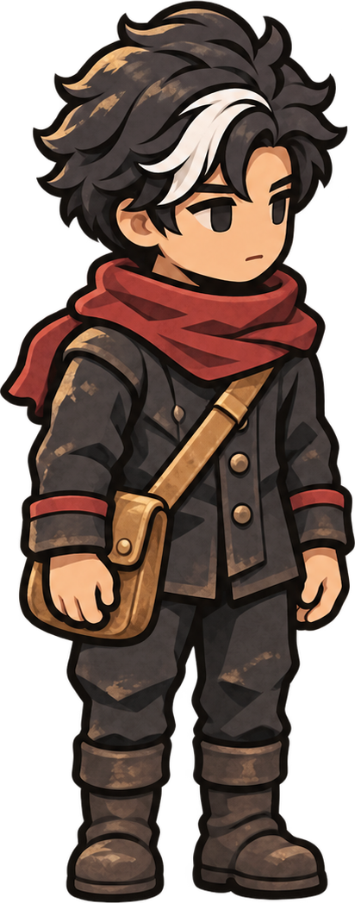

# The Courier in Motion
Novenara / Character animation how-to & style guide / v1.0

[Illustrated character art sheet and booklet (PDF)](art-reference/Novenara-Courier-Animation-Booklet.pdf) · [Directional walk atlas](../dist/assets/courier-ink-walk.webp)

The free-movement village build uses this sprite and the eight-direction atlas. The grid variant keeps V4. The 83-world-pixel height below is the reference for the separate ferry dock playtest; the existing village keeps its original apparent courier height and depth scaling. The approved walk pass still has one cleanup item: align the southwest satchel between idle and walk before reusing that angle for new abilities.

## 01 / Keep him recognizable
Start every animation from the approved Sharper ink southeast idle on the cover, not from whichever new frame is easiest to find. He wears a charcoal jacket, a brick-red scarf and cuffs, dark trousers and boots, and a worn tan crossbody satchel. His very dark hair has one distinct white forelock. Keep the forelock on his right and the satchel on his right hip; the strap crosses from his left shoulder. Show less of those features when he turns away. Do not flip left and right.
- Line and color: crisp near-black contours, warm matte shading and lightly textured fabric. Make the red and ivory readable against the dock without a neon rim or glow. Don’t turn the jacket pure black.
- Silhouette: match the reference head size, shoulder width, jacket hem, and boots. Give the hair and scarf their familiar silhouette before adding seams and buckles. At normal zoom, the white streak, red scarf and tan satchel should read first.
- Scale: use the 83-world-pixel standing body as the dock reference. Keep his ground point at foot contact. Compare him with the existing crate (roughly waist-high), the ticket booth, and the ferryman on the same ground plane. Never resize the body to make an effect look stronger.

## 02 / Make the walk feel natural
Eight facings: S, SE, E, NE, N, NW, W, SW. Free movement remains continuous; the eight sprites only decide what the courier looks like. Do not snap navigation to the art directions.
- Six drawings per heading, 48 walk frames. Add one neutral idle per heading for 56 atlas slots. Keep the approved high-resolution SE idle as the actual in-game idle for that heading. South should read as front, east/west as profile, north as back, and diagonal views as three-quarter.
- Draw six beats: left contact, left support/right passing, right swing, right contact, right support/left passing, left swing. Arms oppose legs; scarf and satchel lag a little. Push the poses apart enough to read without turning this into a run.
- Start at 90 ms per walking frame (540 ms per loop). Do not insert idle into the loop or reset the stride at every diagonal turn. Stop on the idle facing the last actual travel direction. If collision halts travel, stop stepping.
- Fix foot glide before adding more frames. Check the sole on the ground, body size at the seam, and straight up/down movement. If the speed changes, tune cadence to distance traveled instead of speeding up the art blindly. Try eight frames per heading only if six still looks choppy at gameplay size.

## 03 / Build a new ability
1. Write the gameplay intent and the pose the player should recognize. Identify the facing, usable range and whether the skill moves the actor. Start with one representative facing for review, then draw only the facings the move actually needs.
2. Block four readable beats: anticipate, act, hold or follow through, recover. Mark the actual gameplay event (hit, interact, push) on the readable action frame. Keep the contact cue distinct from the visual effect.
3. Put effects on their own layers. Export separate sprites for sparks, flame, gust trails, and persistent light so the same base animation works in combat and exploration. Keep the bag and scarf readable through the effect.
4. Return to the correct directional idle unless movement really changes the facing. Apply movement in game logic; a painted lunge must not silently shift the hitbox.

Cinder Fist example: Raise the closed hand, kindle a small flame around it, hold a readable lit-hand state for exploration, and reuse the flame layer on the impact frame of a punch. Keep the hero the same size. Put the light on its own layer so it can illuminate the cellar without blowing out the sprite.

Gust example: Pull the palm back, show one clean push, then relax. Sync the release to the same beat that moves a barrel or opens the cellar shutter. In combat the move follows the enemy’s displacement rule; the animation does not need three separate effects for light, medium, and heavy targets.

## 04 / Export, test, hand off
- Keep the uncompressed RGBA source plus a clean export. No matte, floor, baked shadow, labels, or particles in the character atlas. Use transparent padding to prevent clipping and bleeding. Do not upscale a low-detail drawing in place of cleaning up the silhouette.
- Current walk atlas: 7 columns × 8 rows of 192 × 256 pixels; column zero is idle and columns 1–6 are walk. All cells use x=96, y=230 as the ground anchor. The reference standing silhouette is 210 atlas pixels tall, rendered at 83 world pixels; use one resize factor across each cycle.
- For a new move, record: action name, directional coverage and order, frame box, ground anchor, durations, event frame, effect attachment point, whether it loops, and how to cancel or exit. Use a stable name such as courier-cinder-fist-v1. Keep the asset, manifest, and test with the code that plays it.
- On the dock, test all eight headings, turn while moving, release into idle, walk into the bench and onto the gangway, use click-to-move, and open Check scale. Compare at normal zoom, not just on an enlarged sheet. Check dark and light terrain, loop seams, true transparency, and reduced-motion behavior before review.
- Keep the last approved look available for comparison. Share a playable draft first. Merge only after review; document any change to scale, facing, anchors, color, or core timing in the project’s style guide and design log.
