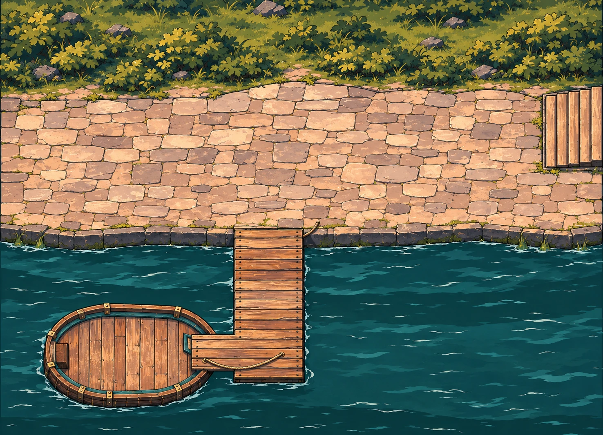
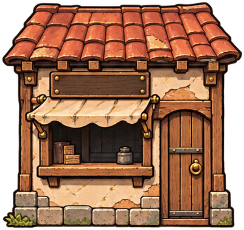

# Cove Way port art

**Direction:** Hand-inked storybook magitech, based on the top Option A panel of the [original art board](art-reference/ferry-arrival-original-board.png). The painted matte surfaces, contours and lighting come from Option A. The production camera is different: north-up, high orthographic 2D, with shallow south-facing walls rather than a diagonal concept-art view.

*Prototype terrain plate. NPCs, booth, lamps, bench, crates and other props are separate in the game.*

## Visual rules

| Element | What to keep |
| --- | --- |
| Line and shadow | Stronger pen contours where silhouettes or overlaps matter; lighter seams and marks. Broad, clearly shaped shadows. Avoid flat vector icons, noisy textures, photoreal materials or global glow. |
| Materials and color | Warm cream plaster, exposed cedar, red terracotta, chipped stone, muted olive planting and river teal. Brass, ceramic fittings and small amber highlights where the technology needs them. Upper-left daylight in the current port. |
| Working harbor | Show signs of use: rope wear, uneven planks, hand-worn ticket ledges and chipped coping stones. An ember lamp reads as a serviceable device through its core, collar and latch. The port is a local ferry landing, not an interrealm portal. |
| Story clues | A fresh House Vessar notice covers an older `COVE WAY FERRY` sign. The loose corner allows both to read. Keep the takeover legible through signage and the guard, without requiring a lore dump. |
| Readability | Keep walking surfaces quieter than interactive objects and hazardous edges. Use the dock boards, retaining wall, steps and waterline to show the path; no tiles visible by default. |

## Scale and layering

Size and anchor assets against the standing courier on a shared ground line. Use **Check scale** in the private playtest to compare the actual in-game props with the courier. The booth roof can exceed a person’s height; judge the booth by the reachable ledge, the usable doorway, and its foundation. The crate reaches approximately waist height; the bench is full length with a knee-height seat; guard and ferryman use the same adult scale. An ember lamp should stand overhead with a latch you can reach. Keep collision at actual ground contact, including buildings; overhangs do not block steps just because they overlap the sprite.

The playtest terrain plate is 1476 × 1066 and drawn into a 1080 × 780 world. Actors and props are independent cutouts; the sign lettering is overlaid rather than baked in. The two images above are examples for contributors, not a runtime asset install. For a new asset, record its source reference, intended physical size, ground anchor, light direction and any foreground occlusion.
