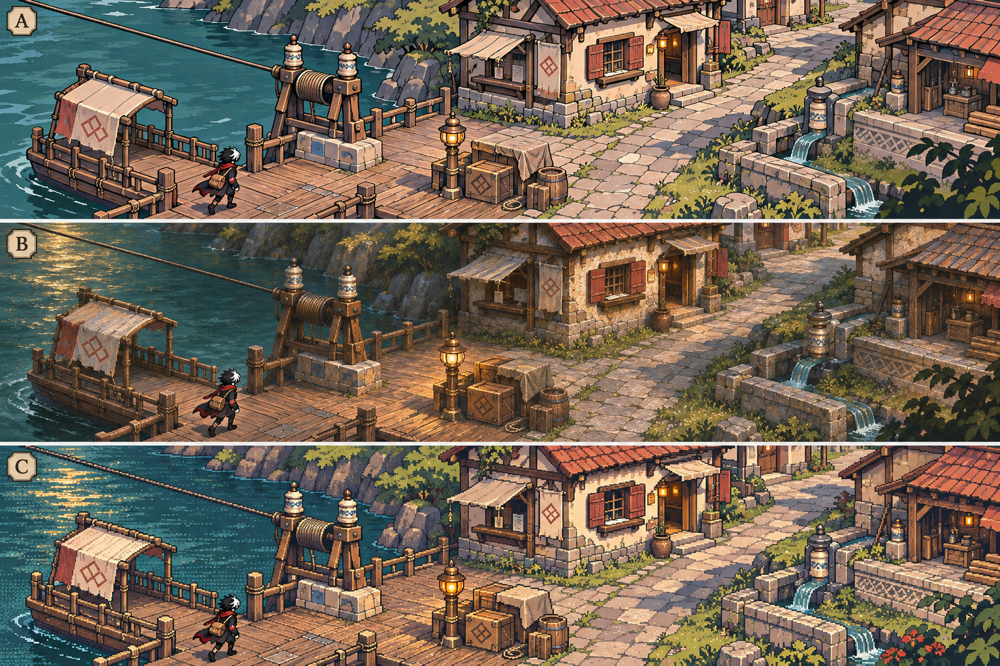

# Novenara · Visual Style Guide

**Version 0.3 · Living document · November 2026**

**Direction:** Hand-inked storybook magitech. Build like a riverside village, draw like an illustrated adventure, and make the magic look like infrastructure someone maintains.

This guide sets the shared visual language for environments, characters, props, and effects. The ferry landing is our first test case, not the template for how every realm must be built. Core rules are established here; prototype details and open decisions are marked as such.

## Reference order

| Reference | Use it for | Do not copy |
| --- | --- | --- |
| [Original ferry-arrival board](art-reference/ferry-arrival-original-board.png), **top panel A only** · 1536 × 1024 source board | Ink weight, warm timber-and-plaster buildings, terracotta roofs, awnings, and practical elemental equipment | The diagonal composition or the painted and pixel treatments in panels B and C |
| [Cove Way port art](COVE-WAY-PORT-ART.md) and [private playtest](https://novenara-ferry-playtest.bfribeiro.chatgpt.site/) | North-up layout, material treatment, arrival staging, and courier-relative scale | The optional hex encounter as a story beat or a commitment to grid combat |
| [The Courier in Motion](COURIER-ANIMATION-HOW-TO.md) and [approved Sharper ink reference](../dist/assets/courier-ink-idle-se.png) | Current courier identity, ink and palette, eight-direction atlas, foot anchor, and ability animation workflow | Mirrored asymmetric details or one asset scale across every realm without a local scale check |

## Drawing rules

- **Ink:** Use confident, slightly irregular contours. Put the strongest line at important silhouettes, overlaps, and interaction edges. Use finer lines for joinery, seams, and wear. Save deep outlines for objects that need to read, rather than tracing every paving stone at the same weight.
- **Shading:** Use broad, clearly shaped shadows and a small number of values per material. Keep reflections, glow, and texture local. A lamp can glow; its entire supporting pipe does not need to.
- **Materials:** Use warm plaster, exposed timber, chipped stone and terracotta at Cove Way. Worn awnings, ceramic mounts, brass fasteners, and repaired planks make the place feel used. Show wear where hands, ropes, water, and feet would actually touch.
- **Palette:** Cove Way starts with warm cream and cedar, terracotta red, river teal, and small amber highlights. These are material and contrast roles, not locked swatches. Keep walkable surfaces quieter than the courier, doorways, hazards, and usable props. Other realms can have their own materials and palette while keeping the same ink and shading logic.
- **Avoid style drift:** No pixel filters, flat vector-icon finish, heavy relief-print hatching, loose gouache repaint, photoreal texturing, or neon applied as decoration. Night and rain can change the mood without changing the drawing style.

## Elemental technology

Start with a daily job and ask how a local person would use an element to do it. Then draw the equipment's source, what it moves or powers, and the part a person could operate or repair. A banked-ember dock lamp has a replaceable heat source and a brass collar. A ferry winch can use ceramic fittings where its mechanism needs insulation. A stone channel routes water to where it is useful.

Make regional differences grow out of climate, available materials, craft, and trade. Cove Way is a remote river village. Freight marks and imported components can hint at interrealm travel without putting a portal on the dock. Separate a suggested mechanism from established lore until it is approved.

## Camera, movement, and combat

- **Camera:** North-up, high orthographic 2D. Show enough roof and shallow south-facing wall to read entrances. Do not use a vanishing point, a diagonal isometric camera, or a different view for each asset.
- **Layout:** Start with the courier and block out walkable surfaces, gangplanks, doorways, stairs, physical hazards, and prop bases in world space before painting. Free exploration does not require a square or hex grid. Paving seams and plank rhythms should follow the materials.
- **Movement:** See [Movement](MOVEMENT.md). Favor actual ground contact over sprite bounds, and preserve usable clearance around props. An awning or roof can overlap the courier visually without blocking the ground beneath it.
- **Combat:** Telegraph hazards and reachable ground through shapes and lighting, not color alone. The dock’s optional hex combat remains a prototype, and its grid does not define the exploration layout or final combat rules.
- **Layering:** Keep actors and movable props separate from the environment painting. Anchor actors at their feet. Where sprites can walk behind an awning or tall prop, split the foreground so occlusion follows where the player stands.

## Courier-to-environment proportions

Use the approved Sharper ink standing silhouette as the ruler. In the ferry dock playtest the body is about 83 world px high. The current ink atlas uses a (96, 230) native ground anchor within each padded 192 × 256 cell. Use the ground anchor and visible silhouette rather than the frame size. Props meet the courier at plausible contact heights: crate around the waist, bench seat at the knee, ticket ledge near the waist, and a doorway above the head. Use **Check scale** to put the courier and a prop on the same ground line. Resize an oversized object only if the art itself is oversized; do not shorten a correctly proportioned bench to fix an oversized collision box.

## Prompt for new artwork

Feed the relevant reference **image and its role** into each request. The words “storybook magitech” alone are not enough.

> **Novenara | [asset and purpose].** Match the visual language of the original ferry-arrival board, top panel A only: hand-inked contours with restrained line weight, clean shaped shadows, matte material color, and localized wear. Use [area and local materials]. This [object/building] helps people [daily task], by [element and visible mechanism], with [part someone would operate or repair]. Match the production north-up gameplay camera, [ground footprint and dimensions], [light direction], and [anchor or occlusion rule]. Keep [walkable and usable parts] visually obvious. Preserve the approved courier design when it appears. No visible grid, captions, neon decoration, pixel treatment, or photoreal rendering.

For each asset, specify output dimensions and transparency/layer needs. For a sprite, specify the sheet rows, frame count, feet anchor and animation cadence. For a prop, specify its footprint and interaction face. For a background, include the level blockout as a **geometry** reference. Record the final prompt and reference version with approved assets; retain unapproved variants separately.

## Art review checklist

- [ ] At play size, the courier, entrance, usable object, and dangerous edge read without turning the grid on.
- [ ] The camera, line weight, light direction, and visible body-to-object scale match the neighboring assets.
- [ ] The same route works by keyboard and pointer. Check entry, tight corners, water edges, and foreground overlap.
- [ ] Any combat or interaction overlay remains legible over the art and reflects actual boundaries.
- [ ] A separately generated prop such as a lamp or crate still looks like it belongs when composited beside the courier.
- [ ] Save the approved frame and standalone assets, their actual resolutions and anchors, and any changes to the reusable prompt.

### Change log

- **0.1:** Captures Option A and the hidden-grid rules; records courier scale as open pending a side-by-side playtest. No game files changed.

- **0.2:** Records approved courier-relative scale and free exploration. Adds a link to the port example and replaces square-grid layout as a design prerequisite. Documentation only.

- **0.3:** Makes the approved ink courier and eight-direction walk the current art reference. The existing grid build retains V4.
